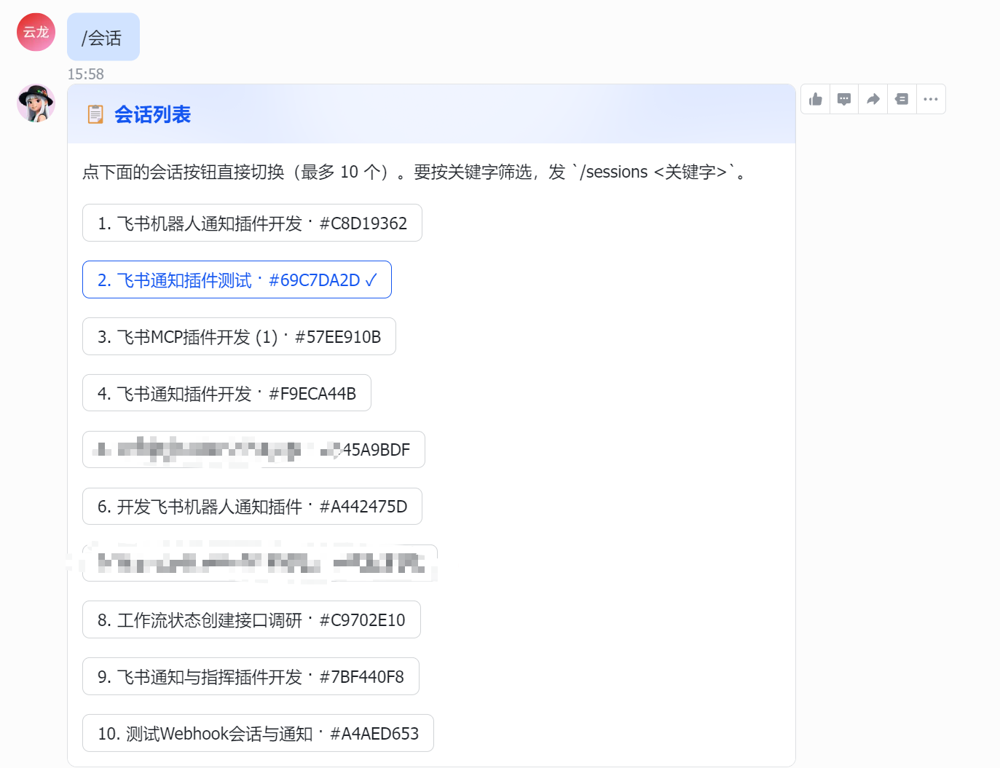
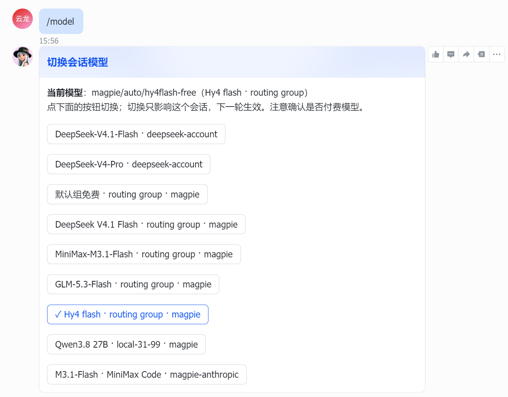
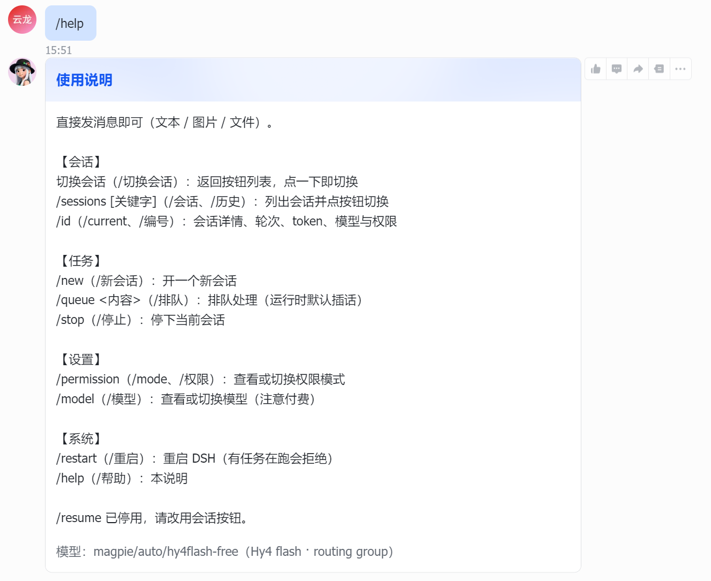

# dsh-feishu-mcp

[](https://github.com/deepseek-ai/deepseek-harness) [](https://nodejs.org/)    

**Drive DeepSeek Harness from Feishu, and get a strong reminder when each turn finishes.** Send a private message to drive a DSH session; text, images, files and folders all work, and the result card comes back to the same chat. Two channels, pick what you need.

## What it does

**1. Private-chat control, results return to the same chat.** A private message enters a DSH session. Busy turns default to inline steering; `/queue` explicitly queues. Switch sessions with buttons; `/id` shows the full status at a glance.



**2. Turn-end reminders.** A card with the conclusion, duration and failure reason; cancelled and sub-agent turns stay silent. Choose a group webhook (`@all` embedded in the card, no extra text) or the Feishu app bot (reply to the original chat, approval/question cards and typing reactions).

**3. Model visibility and switching.** Every result/status card carries the current model in a small footer to warn about paid routes. Send `/model` in Feishu for a button card that switches only this session's model, effective next turn.



**4. Rich media.** Images are downloaded as real bytes; `file` and `folder` messages first show a choice card ("do nothing" / "type instructions"), then download and upload by receipt. Ignore several files and still reference them in text to include all of them. Replying to an old message or restarting the plugin still retrieves the original file by message ID.

**5. Per-chat permissions and sessions.** Four modes (readonly / workspace / Auto Review / full), isolated per Feishu chat; approve or answer from cards. `/help` lists all commands and Chinese aliases.



## Two channels

| Channel | Best for | Capabilities |
| --- | --- | --- |
| Group webhook reminders | Only want completion notices in a group | Simple setup; one card per turn with embedded `@all` |
| Feishu app bot | Want real control from private chat | Text/image/file/folder control, approval/question cards, typing, session binding; long connection, no public callback |

First-time app credentials apply a template default (webhook off, private-chat intake on, `@all`, session and timeout preferences); secrets, allowlists and bindings stay yours, and later explicit choices always win. Two separate test entries: `/test` for the webhook, `/test-app` for the app bot.

## Prerequisites

1. Create an enterprise self-built app in the Feishu Open Platform and enable the bot capability.
2. Grant private-message read, message send, bot-chat read and resource-download scopes (mapped through our own `FSMCP_*` constants in `lib/constants.js`).
3. Under event subscriptions, choose "use long connection to receive events" and add the message receive event; no public IP, domain or callback whitelist needed.
4. Publish a version so permissions and events take effect.
5. Create a custom-bot webhook in a Feishu group for outbound reminders.

Scan-to-create uses the Feishu device-code flow; if your tenant disables it, enter App ID / App Secret manually — same functionality.

## Settings

Open "Settings → Feishu Notification" in the Web GUI, organized into three cards:

- **Global**: turn-end / approval / question notification switches, card title, per-card summary length, session folder, workspace name and default permission. Over-long bodies paginate automatically, never truncated.
- **Feishu app bot**: scan/manual onboarding, test / verify / disconnect, inbound control, reply-back-to-chat, follow-notice switching, session-button limit, dual-surface asking, wait window and allowlist.
- **Group webhook (optional)**: webhook address, `@all`, enable switch, save / test.

Secrets live in `$DSH_HOME/dsh-feishu-mcp/state.json` (mode `0600`); the browser only sees masked tails.

## Commands

Just send a message to enter DSH; commands start with `/`:

| Command | Purpose |
| --- | --- |
| `/help` | Command list and Chinese aliases |
| `/id` (`/current`, `/编号`) | Session status: turns/steps, tokens and cache hit, context, model, permission |
| Switch session / `/sessions` (`/会话`, `/历史`) | List session buttons, tap to switch |
| `/new` | Start a new session |
| `/queue` | Queue this message instead of steering |
| `/permission` (`/mode`, `/权限`) | View or switch permission mode |
| `/model` | View or switch this session's model |
| `/stop` | Stop the current session |
| `/restart` | Restart DSH (refused while a task is running) |

`/resume` is deprecated; use session buttons instead.

## Status

- `npm test`: 46/46 passing (10 test files); all JS/MJS files pass `node --check`.
- Outbound webhook verified against a real Feishu bot (`StatusCode:0`, `code:0`).
- App bot connection and test message verified in the UI; inbound long connection is implemented and unit-tested, ready for live verification with App credentials and event subscription.
- File/folder recognition, model visibility/switching and follow-notice session switching are covered by unit tests over the full chain and failure branches.

## Install

```bash
npm install
```

Then install the local directory with the DSH plugin manager, or update the installed version in settings. Plugin entry: `include:feishu-mcp`.

> **After the first install or an upgrade**: **fully quit the whole DeepSeek Harness process and launch it again** (closing the settings window or the DSH window is not enough). The Host module and new routes are only loaded on a full restart. Reopen "Settings → Feishu Notification" afterwards. Without a restart the plugin will not take effect and the page may show `HTTP 404` or a stale version.

More implementation detail: [docs/DETAIL.md](docs/DETAIL.md).
