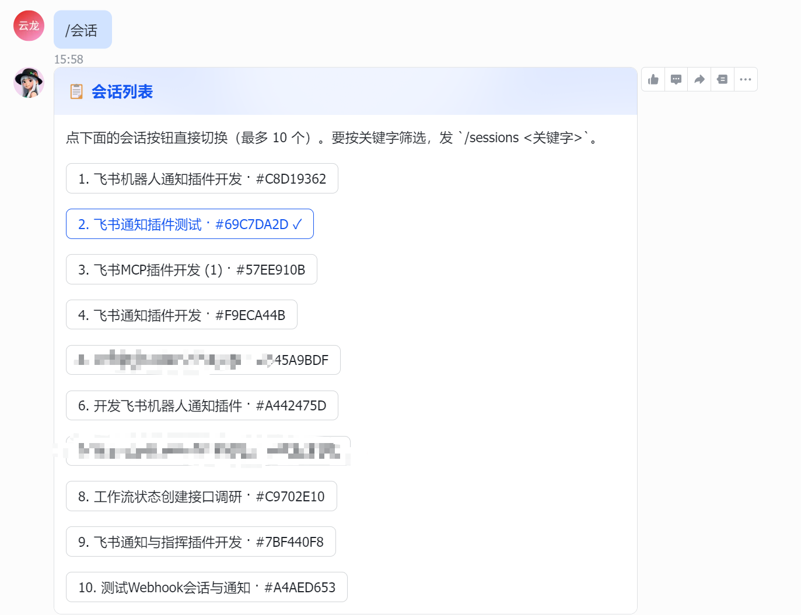
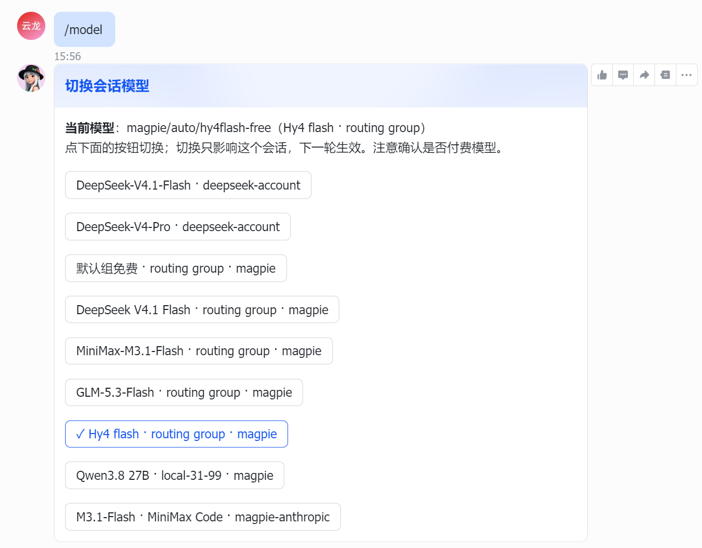
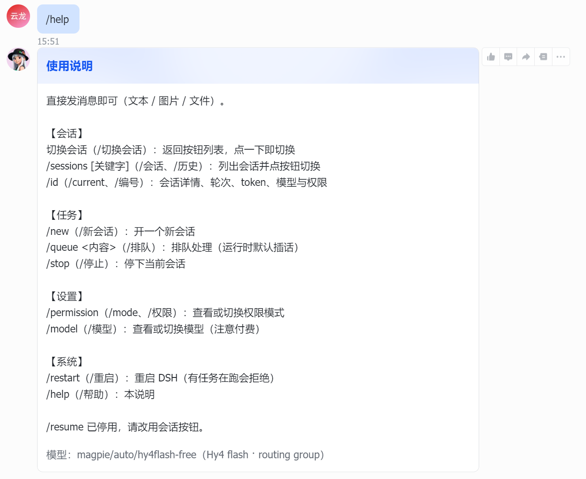

# dsh-feishu-mcp

[](https://github.com/deepseek-ai/deepseek-harness) [](https://nodejs.org/)    

**在飞书里直接指挥 DeepSeek Harness，并把每一轮的结论强提醒给你。** 私聊发一条消息就能驱动 DSH 干活，文本、图片、文件、文件夹都能交给它；任务结束的结果卡片回到同一个对话。配置简单，两条通道按需选择。

## 它能做什么

**① 私聊指挥，结果回原对话。** 在飞书私聊里给机器人发消息，就进入一个 DSH 会话；忙的时候默认插话引导当前轮，显式 `/queue` 才排队。会话用按钮切换，`/id` 一条命令看全程状态。



**② 每轮结果强提醒。** 任务结束推卡片，含结论、用时和失败原因；取消和子代理轮次静默。可选群 Webhook（`@all` 内嵌卡片正文，不额外发文本）或飞书应用机器人（回原私聊、支持审批/提问卡片与 Typing 反应）。

**③ 模型看得见、随时切。** 每张结果/状态卡底部都有当前模型小字，提醒确认付费模型；私聊发 `/model` 打开按钮卡，点一下只为这个会话切换模型，下一轮生效。



**④ 富媒体都能处理。** 图片下载真实字节交给模型识别；文件、文件夹先弹选择卡（「什么也不做」/「输入文本」），补一句说明后再下载、按会话上传回执。多个文件都点忽略后，在文字里引用它们仍会全部带上；回复旧消息或插件重启后，按消息 ID 回查飞书也能取回原文件。

**⑤ 权限与会话按对话隔离。** 只读 / 工作区读写 / Auto Review / 完全权限四种模式，每个飞书对话独立；审批卡、提问卡在飞书里点按钮即可继续。`/help` 列出全部指令与中文别名。



## 两条通道

| 通道 | 适合场景 | 能力 |
| --- | --- | --- |
| 群 Webhook 强提醒 | 只想在群里收到完成提醒 | 配置简单；每轮一张卡片，支持内嵌 `@all` |
| 飞书应用机器人 | 想在私聊里真正指挥 DSH | 私聊指挥（文本/图片/文件/文件夹）、审批/提问卡、Typing、会话绑定；长连接，无需公网回调 |

首次配置应用机器人时会自动套用一套模板默认（关闭 Webhook、开启私聊入站、`@all`、会话数量与等待上限等偏好），密钥、白名单和会话绑定不受影响；之后以你的显式选择为准。两个测试入口独立：`/test` 只测群 Webhook，`/test-app` 只测应用机器人。

## 飞书前置条件

1. 在飞书开放平台创建企业自建应用，开启「机器人」能力。
2. 开通私聊消息接收、发送消息、读取机器人所在会话、下载消息资源等权限（统一在 `lib/constants.js` 中用自有常量 `FSMCP_*` 映射，业务代码不散写官方标识）。
3. 「事件订阅」选择**使用长连接接收事件**，添加消息接收事件；无需公网 IP、域名或回调白名单。
4. 发布应用版本让权限与事件订阅生效。
5. 群 Webhook 另需一个自定义机器人地址（群设置 → 机器人 → 添加自定义机器人）。

扫码创建使用飞书设备码注册流程；租户禁用该入口时用「手动连接」填 App ID / App Secret，功能一致。

## 设置界面

刷新 Web GUI，进入「设置 → 飞书通知」，界面分三块：

- **全局设置**：任务完成 / 授权 / 提问三类通知开关、卡片标题、每张卡片摘要长度、会话工作文件夹、工作区名称、默认权限。正文超长会自动分页，不截断。
- **飞书应用机器人**：扫码创建 / 手动连接、测试 / 校验 / 断开、允许指挥、启用私聊入站、结果回原私聊、跟随通知切会话、会话按钮数量、双端询问与等待上限、允许的 open_id。
- **群 Webhook（可选）**：Webhook 地址、`@all`、启用开关、保存 / 测试。

密钥只保存在 `$DSH_HOME/dsh-feishu-mcp/state.json`（权限 `0600`），浏览器只拿到末 4 位掩码，不接触 Webhook 原文或 App Secret。

## 常用指令

私聊直接发消息即进入 DSH；以下指令以 `/` 开头：

| 指令 | 作用 |
| --- | --- |
| `/help`（`/帮助`） | 指令说明与中文别名 |
| `/id`（`/current`、`/编号`） | 会话状态：轮次/步数、Token 与缓存命中、上下文、模型、权限 |
| 切换会话 / `/sessions`（`/会话`、`/历史`） | 列出会话按钮，点一下切换 |
| `/new`（`/新会话`） | 开一个新会话 |
| `/queue`（`/排队`） | 把本条排队处理，而不是插话 |
| `/permission`（`/mode`、`/权限`） | 查看或切换权限模式 |
| `/model`（`/模型`） | 查看或切换本会话模型 |
| `/stop`（`/停止`） | 停下当前会话 |
| `/restart`（`/重启`） | 重启 DSH（有任务在跑会拒绝） |

`/resume` 已停用，请改用会话按钮。

## 验证状态

- `npm test`：46/46 通过（10 个测试文件）；全部 JS/MJS 脚本 `node --check` 通过。
- 出站 Webhook：已用真实地址发送卡片（内嵌 `@all`），返回 `StatusCode:0 / code:0`。
- 应用机器人：扫码连接与测试消息已通过界面验证；长连接入站代码与单测就绪，接上 App 凭据与事件订阅即可联调。
- 文件与文件夹、模型可见与切换、通知会话跟随：均有单测覆盖完整链路与失败分支。

## 安装

```bash
npm install
```

用 DSH 插件管理器安装本地目录，或在设置页更新已安装版本。插件入口为 `include:feishu-mcp`。

> **首次安装或更新后**：请**完全退出整个 DeepSeek Harness 进程再重新启动**（不是只关闭设置窗口或 DSH 窗口），Host 模块和新路由才会加载；重启后再打开「设置 → 飞书通知」。只关窗口不重启，插件不会生效，页面会出现 `HTTP 404` 或仍显示旧版本。

更多实现细节见 [docs/DETAIL.md](docs/DETAIL.md)。
